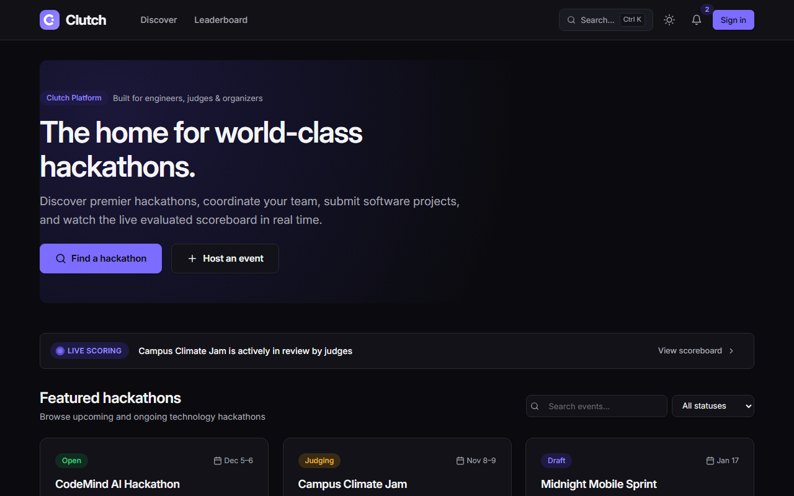
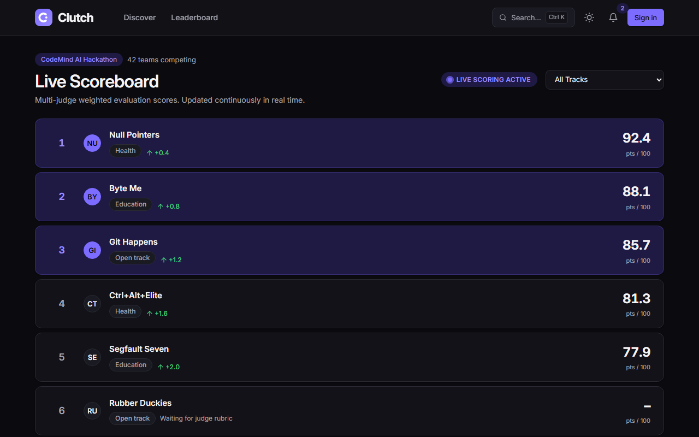
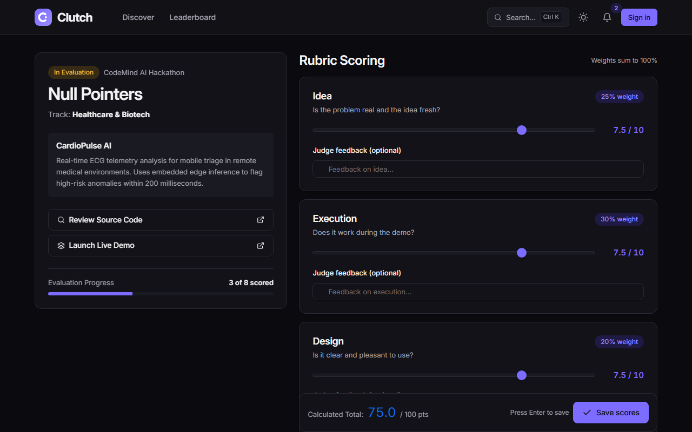
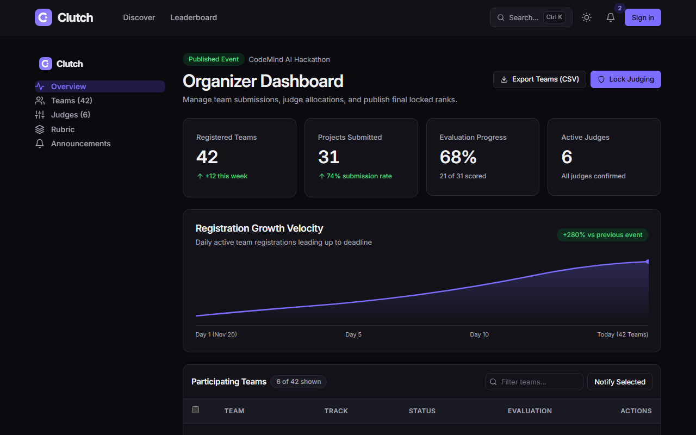

# Clutch

**Hackathon management portal** for running technical events end-to-end: event discovery, team registration with invite codes, project submissions, weighted multi-judge rubric scoring, and a live SignalR scoreboard.

Built with **ASP.NET Core 8 MVC**, **EF Core 8 + SQL Server**, **ASP.NET Core Identity**, **SignalR**, and a custom dual-theme (Light / Dark) WCAG 2.1 AA product UI.

---

## Preview

| Discover Events | Live Scoreboard |
|---|---|
|  |  |

| Judge Rubric Scoring | Organizer Dashboard |
|---|---|
|  |  |

---

## Features by Role
- **Public & Participants**: Browse published hackathons, create teams or join via 8-character invite codes, manage rosters, submit source repositories and live demos before deadlines, and download printable result certificates.
- **Judges**: Evaluate assigned hackathons on a split submission/rubric view with interactive weighted sliders, live weighted totals, feedback notes, and conflict-of-interest checks (judges cannot score their own team).
- **Organizers**: Configure tracks and weighted rubric criteria (enforced to sum to 100%), transition event lifecycle (`Draft -> Published -> Closed -> Finalized`), assign judges, publish announcements, export CSV reports, and lock judging.
- **Administrators**: Manage platform users, lock/finalize scoring, and inspect the immutable security audit log (`/admin/audit`).

---

## Tech Stack
- **Backend**: .NET 8, ASP.NET Core MVC (Razor Views), ASP.NET Core Identity, SignalR
- **Database**: Entity Framework Core 8 + SQL Server 2022
- **Frontend**: Bootstrap 5 grid + custom design token layer (`wwwroot/css/clutch-theme.css`), Lucide SVG sprite (`wwwroot/img/icons.svg`), anti-FOUC Light/Dark/System theme engine
- **Testing & Quality**: xUnit, FluentAssertions, `WebApplicationFactory`, WCAG 2.1 AA automated contrast verification (`tools/contrast-check/check_contrast.py`)
- **DevOps**: Multi-stage Docker & Docker Compose, GitHub Actions CI + GHCR Deploy workflows

---

## Run Locally

### Option A — Local SQL Server (Express / LocalDB)
1. Install **.NET 8 SDK** and SQL Server Express (or LocalDB).
2. Configure your connection string in User Secrets:
   ```powershell
   dotnet user-secrets set "ConnectionStrings:DefaultConnection" "Server=.\SQLEXPRESS;Database=ClutchDb;Trusted_Connection=True;MultipleActiveResultSets=true;TrustServerCertificate=True" --project src/Clutch.Web
   ```
3. Apply EF Core migrations:
   ```powershell
   dotnet ef database update --project src/Clutch.Web
   ```
4. *(Optional)* Seed roles, admin, and demo hackathon data (set temporary env vars first):
   ```powershell
   $env:SeedAdmin__Email="admin@clutch.local"
   $env:SeedAdmin__Password="YourStrongAdminPassword!"
   $env:SeedDemo__Password="YourDemoUserPassword!"
   dotnet run --project src/Clutch.Web -- --seed-demo
   ```
5. Start the app:
   ```powershell
   dotnet run --project src/Clutch.Web
   ```
   Open `https://localhost:7140` or `http://localhost:5240`.

### Option B — Docker Compose (App + SQL Server 2022)
1. Copy `.env.example` to `.env` and fill in strong passwords:
   ```bash
   cp .env.example .env
   ```
2. Start database and web container:
   ```bash
   docker compose up -d --build
   ```
3. Apply migrations and seed roles/admin:
   ```bash
   dotnet ef database update --project src/Clutch.Web
   docker compose exec web dotnet Clutch.Web.dll --seed
   ```
4. Verify health:
   ```bash
   curl http://localhost:8080/health
   ```

---

## Testing & Verification
```bash
# Build and run all unit & integration tests (48 tests)
dotnet build
dotnet test

# Verify WCAG 2.1 AA contrast compliance across light & dark tokens
python tools/contrast-check/check_contrast.py
```

---

## Documentation
- [Product Requirements](docs/PRD.md)
- [Architecture & Routes](docs/ARCHITECTURE.md)
- [Database Schema](docs/DB_SCHEMA.md)
- [Design System & Dual-Theme Tokens](docs/DESIGN_SYSTEM.md)
- [Brand Identity Guide](docs/BRAND.md)
- [WCAG Contrast Compliance Report](docs/CONTRAST_REPORT.md)
- [Deployment & Operations Guide](docs/DEPLOYMENT.md)
